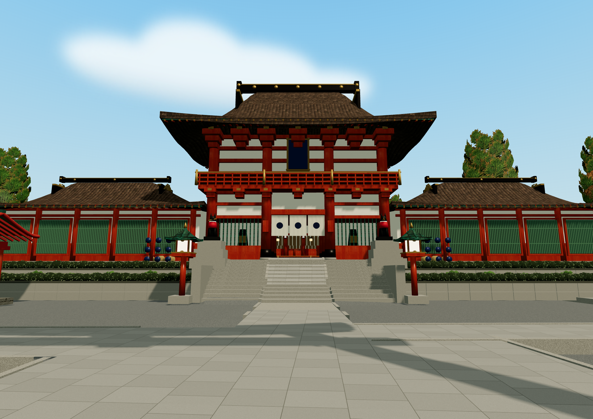
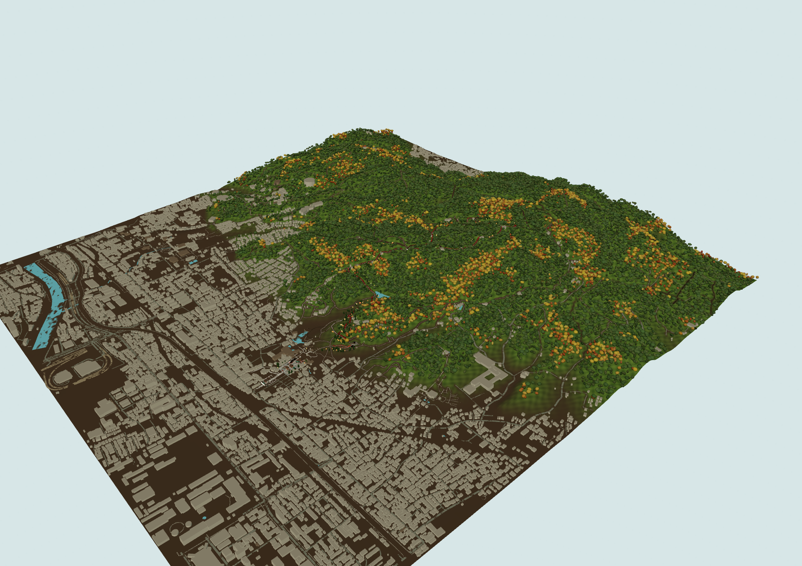
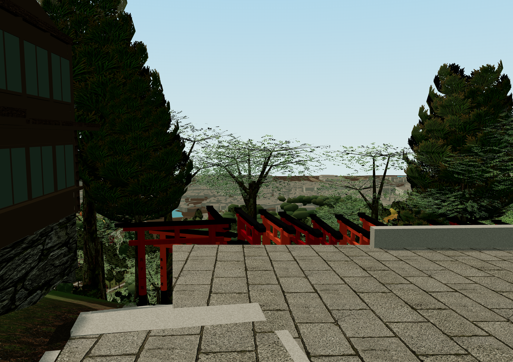
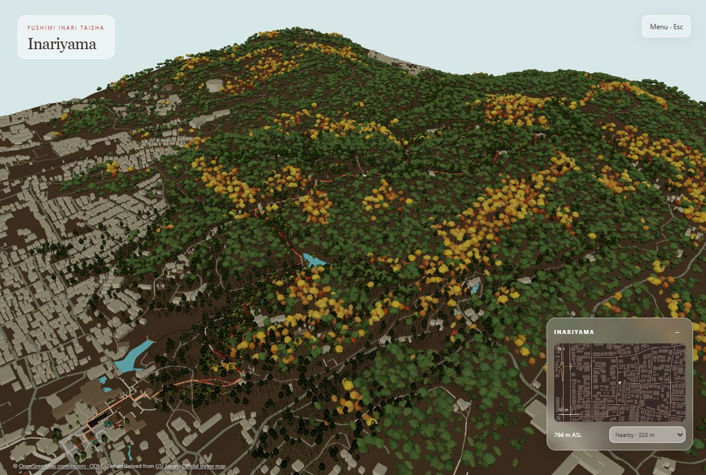
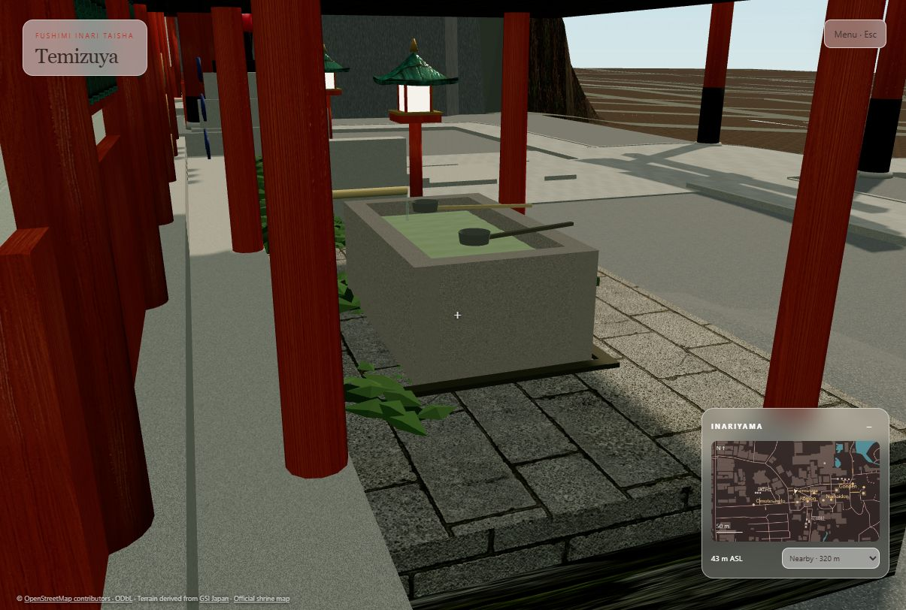

# Fushimi Inari · Inariyama Explorer

**A walkable reconstruction of the shrine precinct and mountain trails in Kyoto.**

Made by [Ignacio Estevo](https://nachoestevo.com).



Explore the preserved architectural scene on a geographic trail network: the Rōmon entrance, Senbon Torii, tea houses, secondary paths and the ascent to Ichinomine. Switch between walking, free flight and orbit view, or jump to a checkpoint from the menu.

> Work in progress. This is a reference-driven reconstruction, not a surveyed digital twin. The screenshots show the actual viewer, not concept renders.

## From the entrance to the mountain



The geographic study area spans approximately **2.55 km east–west × 2.45 km north–south**, including surrounding neighbourhoods. This rectangle is **not the legal shrine estate boundary**. The mountain, trail network and urban context share a metre-based coordinate system without vertical exaggeration. City buildings are simplified volumes; forest coverage and individual crowns are interpretive.



**Yotsutsuji · Kyoto view.** A ground-level view connects the terrace, descending torii and distant city. These three new images were exported directly through Photo mode on **20 October 2026**, at **1920 × 1356**, without navigation overlays or retouching. They document the current model, including its remaining visual limitations.

## Run locally

Requires Python 3 for serving files and a desktop browser with WebGL. Three.js loads from a pinned CDN version, so the first load needs internet access. The scene contains large assets; allow the initial load to finish.

From the repository root:

```powershell
python -m http.server 8420 --bind 127.0.0.1 --directory fushimi_inari
```

Open [the integrated world](http://127.0.0.1:8420/integrated-world/index.html).

## Explore

The Checkpoints tab includes Yotsutsuji, Kojingamine and the western trail
outlook. An additional west-facing bench sits on a planted margin at Yotsutsuji.
City facade detail is built on first approach to these outlooks, shown within
135 m and hidden beyond 180 m (or outside 115–340 m camera elevation). It retains
its buffers for reuse; the ordinary low-cost aerial massing remains available.
Footprints are mapped, while windows, building heights without OSM metadata and
the added bench placement are interpretive. See [R28 notes](docs/r28-outlooks.md).

| Control | Action |
| --- | --- |
| **Esc** | Open the tabbed exploration menu |
| **W A S D** | Move while walking or flying |
| **Drag** | Look around |
| **Shift** | Move faster |
| **R / Space**, **F / Ctrl** | Fly up / down |
| **E** | Interact with supported objects |
| **Checkpoints** | Teleport to a named location |
| **Environment** | Spring / Autumn, lighting and ambient sound |
| **Photo mode** | Pan, tilt, field of view, exposure and clean PNG export up to 3840 px |

The minimap follows your position. Movement speed, free flight, routes and sound are available in the menu. Start with **Rōmon**, **Temizuya**, **Shrine reception** or **Senbon Torii**.

**Night** adds luminous stars with gentle scintillation. Press **L** to toggle your
flashlight, or use **Environment → Personal light**. Reception visitors use external
CC0 rigged models with skeletal idle animation; see [credits](fushimi_inari/assets/models/visitors/CREDITS.md)
and [R32 scope](docs/r32-visitors-and-night.md). Characters remain stylized.

At **Temizuya**, approach and aim at the basin, then press **E** to lift a ladle.
At **Shrine reception**, aim at the attendant under the Goshuin sign for a
commemorative stamp demonstration. At **Ichinomine**, approach the hanging rope
and press **E** to ring the bell. Enable sound in **Environment** to hear the
existing effects. The attendant is adapted from a CC0 Quaternius rigged character;
the entrance kitsune are original procedural models. Both remain stylized, not scans.
See the [model credits](fushimi_inari/assets/models/visitors/CREDITS.md),
[R33 reception refinement](docs/r33-reception-and-ground.md) and
[animation regression checks](fushimi_inari/tests/README.md).

For the city outlook, choose **Checkpoints → Yotsutsuji · Kyoto view**. The existing forecourt has resting benches and an open stair approach. Its furniture dimensions are inferred from references; the distant city remains simplified mapped massing.

**Photo mode** holds your position and hides navigation overlays. Adjust the composition, optionally show a thirds grid, then **Save PNG**. Exports retain the screen aspect ratio with a 1920 or 3840 pixel longest edge; the grid and controls are excluded. **Open last photo** provides the latest capture if the browser does not download automatically. **Esc** restores the original camera settings and exploration controls. High-resolution rendering is temporary and uses the existing renderer.

## Seasons and upper court



Choose **Esc → Environment → Season** for fresh spring greens or autumn gold and amber. The choice persists locally. Evergreen trees retain their green foliage; sparse spring flowering crowns are interpretive, not surveyed tree locations. Seasonal changes reuse the same geometry and textures.

The Naihaiden ascent now connects to the lower court and upper side platforms, with finer granite and stitched terrain boundaries. Dimensions remain video-guided estimates. See [R24 references and walking checks](fushimi_inari/integrated-world/REFERENCES-R24.md).

The twin Senbon exits now open onto a connected Okusha court, with the original ema and Omokaru details retained and mapped lateral buildings added. Exterior sanctuary approaches follow OSM paths. Preserved tree crowns now have lightweight distant substitutes. See [R25 reference, walking and performance checks](fushimi_inari/integrated-world/REFERENCES-R25.md).

## Entrance details

The lower court shares a connected ground level, with original building pedestals retained. Surrounding OSM building footprints and lightweight distant forest crowns provide context for aerial exploration. Google Maps satellite views guide broad woodland coverage; building heights and individual trees remain approximate. Toggle these layers under **Esc → Routes → Layers and sources**. See [R23 reference and validation notes](fushimi_inari/integrated-world/REFERENCES-R23.md).



The original buildings remain the foundation of the scene. Current refinements include grey slab paving and aggregate, gilded fittings, curved gable ornaments, leafy shrubs, a hollow purification basin with animated water, and additional detail on the original approach shops.

The reception building follows the mapped Juyosho footprint. Counter interiors, furnishings and the particular goshuin window are interpretive. Personal visit photographs guide materials and details; they are not uploaded or redistributed here.

## What is sourced—and what is still approximate

The [sector review and reconstruction queue](docs/sector-review.md) tracks current
coverage, timestamped video observations, official-map omissions and physical
access findings. Its [R35 runtime audit](docs/audits/sector-audit-r35.json) separates
mapped connectivity from collision and height checks.

| Layer | Status |
| --- | --- |
| Trail connectivity | OpenStreetMap node topology; alternative routes remain distinct |
| Broad terrain | GSI elevation data; the baseline is a 10 m grid |
| Building placement | Mapped anchors with preserved original architecture |
| Steps and local grading | Mixed source counts and inferred profiles; the [recorded 52-profile audit](fushimi_inari/integrated-world/profile-walk-audit-r14.json) checks centreline continuity, but marks real-world fidelity unverified |
| Vegetation and minor furnishings | Reference-informed, unsurveyed placement |
| Reception, shops and gables | Visual reconstruction; exact dimensions and counter locations remain unverified |
| Torii | Regional size and inscription variations; individual dimensions, spacing and donor inscriptions are not an exact inventory |
| City panorama | Mapped footprints with simplified, partly inferred heights and facades |

There is **no measured overall accuracy percentage**. Geographic provenance does not establish centimetre-level placement, accurate step geometry or a complete inventory of shrine details. Automated route and walking checks establish model behaviour, not correspondence to the physical site.

The strongest foundation is broad terrain and mapped route connectivity. The largest fidelity gaps are local platforms and stairs, building proportions and roof profiles, shrine-specific furnishings, vegetation structure and the city skyline. Earlier access and ground-transition audits are not a current exhaustive clearance survey. Static meshes are batched and vegetation is spatially partitioned, but a complete performance qualification has not been completed.

See [R18 video references](fushimi_inari/integrated-world/REFERENCES-R18.md), [R17 references and validation](fushimi_inari/integrated-world/REFERENCES-R17.md), [personal-photo reference notes](fushimi_inari/integrated-world/REFERENCES-R16.md), and the [geographic manifest](fushimi_inari/geography/manifest.json).

## Project structure

| Path | Contents |
| --- | --- |
| `fushimi_inari/integrated-world/` | Current interactive world and geographic integration |
| `fushimi_inari/geography/` | Map data, elevation data and geographic algorithms |
| `fushimi_inari/interactive_viewer/` | Preserved original viewer |
| `fushimi_inari/index.html` | Original scene presentation |
| `fushimi_inari/scripts/` | Build, extraction and audit scripts |
| `fushimi_inari/assets/` | Textures, models and audio |
| `docs/images/` | Selected live-viewer screenshots for this README |
| `fushimi_inari/outputs/` | Local captures and audits, excluded from Git |

The Blender master and scene specifications are preserved in `fushimi_inari/`. The `r03-baseline` Git tag preserves the integration before the torii correction.

## Develop and verify

The current integrated entry point is maintained in `fushimi_inari/integrated-world/`. The old `build_integrated_viewer.py` is a historical bootstrap and does not reproduce later refinements; do not run it over the current viewer. Validate changes with:

```powershell
node --test fushimi_inari/geography/*.test.mjs fushimi_inari/integrated-world/*.test.mjs
```

`legacy-builders.mjs` is generated from the original viewer; scene refinements belong in the integration adapters. Keep the original source viewers intact. Browser inspection is required for geometry, materials, camera clearance and shader changes—unit tests alone do not establish visual correctness.

## Sources and rights

- Map data: [OpenStreetMap contributors](https://www.openstreetmap.org/copyright), ODbL.
- Elevation data: [Geospatial Information Authority of Japan](https://maps.gsi.go.jp/development/demtile.html).
- Site reference: [official Fushimi Inari shrine map](https://inari.jp/trip/map01/).
- Bird recording: [audio credits](fushimi_inari/assets/audio/CREDITS.md). The uguisu recording is CC BY-SA 3.0 and was recorded in Kantō, not Inariyama.

Private working repository. No blanket redistribution license is granted for third-party material. External photographs remain references rather than bundled textures. Selected documentation images are screenshots of this project.
