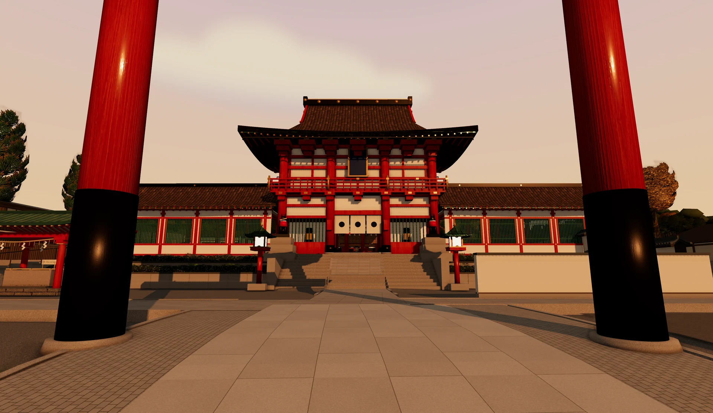
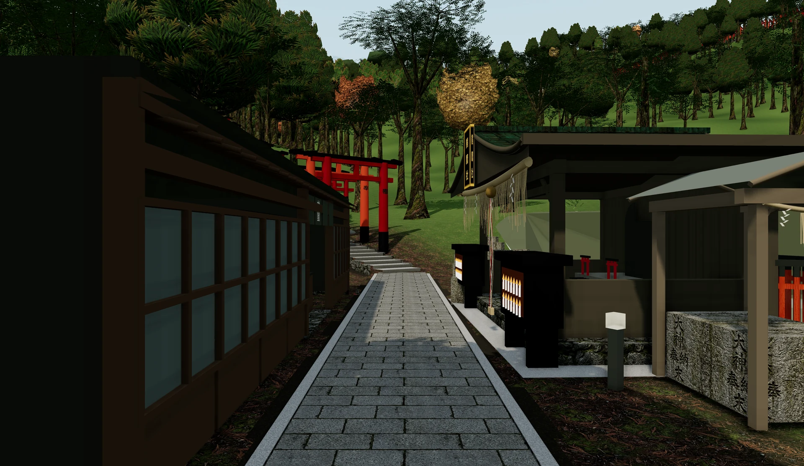
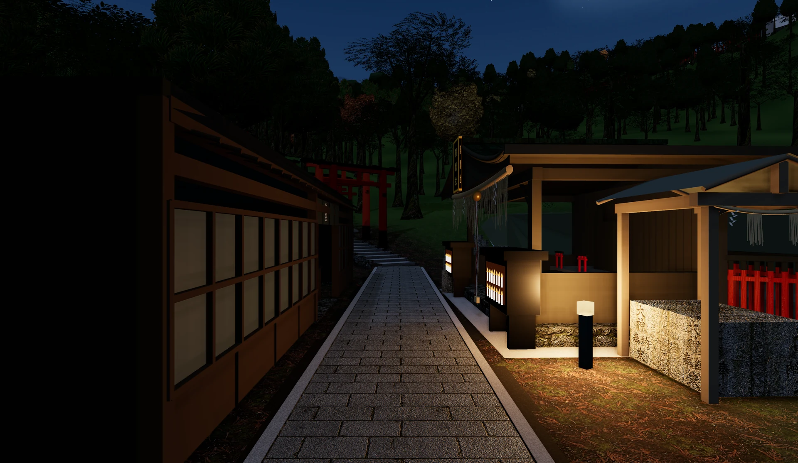

# Fushimi Inari · Inariyama Explorer

**Arrive by train. Walk Kyoto's streets. Follow the torii into the mountain.**

An interactive, reference-driven reconstruction by [Ignacio Estevo](https://nachoestevo.com), built with Three.js.



Start aboard a Keihan train: Japanese and English arrival announcements finish before the doors open. Leave the platform, pass the automatic IC-card gates, and follow the streets past shops, food counters, vending machines and the JR crossing. The default route turns toward **Omotesando's first torii**, reaches the shrine and continues around the **summit loop**—approximately **4.38 km** in the model.

## Three ways to see Inariyama



**Day** reveals the timber, stone paving, inscriptions and woodland. Walk the public paths and courtyards. Checkpoints, free flight and orbit remain available through explicit debug URLs.



**Sunset and night** change the sun, sky and local lighting. Warm trail markers make the route legible from above; stars, field recordings and nearby chimes add atmosphere. The light placements and some sounds are interpretive, rather than a record of every real fixture or railway.

These photographs were exported from the actual viewer on **24 October 2026** with **Ultra** enabled. The README uses compressed WebP copies; the scene was not retouched or generated for the screenshots.

## Run locally

Use Python 3 and a modern desktop browser. WebGPU is preferred, with a WebGL 2 backend fallback. The pinned Three.js CDN requires internet on first load.

```powershell
python -m http.server 8420 --bind 127.0.0.1 --directory fushimi_inari
```

Open [Inariyama Explorer](http://127.0.0.1:8420/integrated-world/index.html). Wait for **Enter** to start the arrival with sound. `?intro=0` skips the welcome screen; sound then requires a gesture.

| Control | Action |
| --- | --- |
| **W A S D**, drag | Move and look |
| **Slow / Fast**, **Shift** | Choose pace; hold Shift to sprint |
| **Esc** | Pause and open Explore, Routes or Settings; keep the current movement mode |
| **R / Space**, **F / Ctrl** | Ascend / descend in Fly mode |
| **E** | Use supported objects |
| **M**, **L** | Toggle sound / flashlight |
| **Explore → Go to a place** | Jump to station, shrine or mountain checkpoints |
| **Photo mode** | Pan, tilt, field of view, exposure and clean PNG export up to 3840 px |

## Quality and performance

**Balanced is the default.** Choose a preset in **Settings → Rendering quality**.

| Preset | Rendering |
| --- | --- |
| Balanced | Up to 2 million pixels, 1024 px shadows, nearby 512 px WebP textures |
| High resolution | Up to 3 million pixels, 2048 px shadows, balanced textures |
| Ultra | Up to 4 million pixels, 4096 px shadows, nearby original textures and increased filtering/detail range |

Natural, Sakura and Dreamcore atmospheres share WebGPU materials, bloom and environment lighting. Station reflections and nearby lights are locally tuned. Cloud shade is a lightweight terrain approximation. Architectural dimensions remain partly inferred.

## Loading and hosting

The station loads first; four detailed shrine models (24.3 MB compressed) load one at a time near the precinct. Permanent floors and collision data remain available independently. Nearby textures stream progressively; loaded assets remain cached rather than being evicted.

Run `node scripts/build-static.mjs` to build the selected static site in `dist/` (approximately 85 MB total, not the initial download). Vercel uses `vercel.json`. Internal reports, source models, tests and captures are excluded from the published site. Current cold-load time and performance depend on browser, device and network; historical screenshots are not performance measurements for this version.

## What is reconstructed

- **Station and streets:** Keihan arrival, automatic fare gates, street commerce, pedestrians, interactive vending machines and a passing JR train. The separate JR Inari approach remains available.
- **Shrine precinct:** Rōmon, purification basin, reception, upper courts, bifurcated Senbon Torii and Okusha, including lateral boundaries and offerings.
- **Mountain:** tea houses, stone stairs, varied torii inscriptions, Yotsutsuji's city view, summit shrines and return paths. The short Ōsugi access now reaches its mapped shrine.
- **Interaction:** walk, fly, orbit, routes, minimap, seasons, recorded footsteps, sound controls, flashlight and photography.


The geographic study area spans approximately **2.55 × 2.45 km**; it is not the legal shrine boundary. Trail topology comes from OSM and broad terrain from GSI elevation data. Local grading, roof profiles, small furnishings, donor inscriptions, trees, shop inventories and the simplified city skyline contain visual estimates. There is no measured overall accuracy percentage. This remains a work in progress, not a surveyed digital twin.

## Develop and verify

The current entry point is `fushimi_inari/integrated-world/`. The original viewer and Blender sources are preserved. Do not run the historical `build_integrated_viewer.py` bootstrap over the current implementation.

For local geometry tests, install the matching Three.js package if needed:

```powershell
npm install --no-save --package-lock=false three@0.164.1
node --test fushimi_inari/geography/*.test.mjs fushimi_inari/integrated-world/*.test.mjs
```

Browser review is required for materials, shaders, camera clearance and UI changes; tests alone do not prove visual fidelity. Current validation and known limits are in [the release notes](docs/ultra-quality-and-release.md). The [sector review](docs/sector-review.md) retains reference and reconstruction history.

| Path | Purpose |
| --- | --- |
| `fushimi_inari/integrated-world/` | Runtime and interaction modules |
| `fushimi_inari/geography/` | Map, elevation and routing data |
| `fushimi_inari/assets/` | Runtime textures, models and credited audio |
| `fushimi_inari/scripts/` | Build and audit tools |
| `docs/` | Selected documentation, photos and reference notes |
| `outputs/`, `.tmp/`, `fushimi_inari/outputs/` | Local captures, experiments and recovery archives; new files excluded from Git |

For hosting, serve `fushimi_inari/` as the static root and route `/` to `integrated-world/index.html`. Exclude local outputs and references. Social metadata currently names the planned `kyoto.nachoestevo.com` domain; verify it before publishing. No hosting deployment is implied by a Git push.

## Sources and credits

- [OpenStreetMap contributors](https://www.openstreetmap.org/copyright), ODbL: mapped trails and footprints.
- [GSI Japan](https://maps.gsi.go.jp/development/demtile.html): elevation data.
- [Official Fushimi Inari map](https://inari.jp/trip/map01/): site reference.
- [Rail recording sources](fushimi_inari/assets/audio/recorded-rail/manifest.json), [station voices and gate](fushimi_inari/assets/audio/recorded-station/CREDITS.md), [footsteps](fushimi_inari/assets/audio/footsteps/CREDITS.md), [bird audio](fushimi_inari/assets/audio/CREDITS.md).
- [Character credits](fushimi_inari/assets/models/visitors/CREDITS.md): stylized CC0 rigged visitors.

Private working repository. Third-party assets retain their individual rights; no blanket redistribution license is granted. Reference photographs are not bundled as scene textures. Documentation images show this project's viewer.
