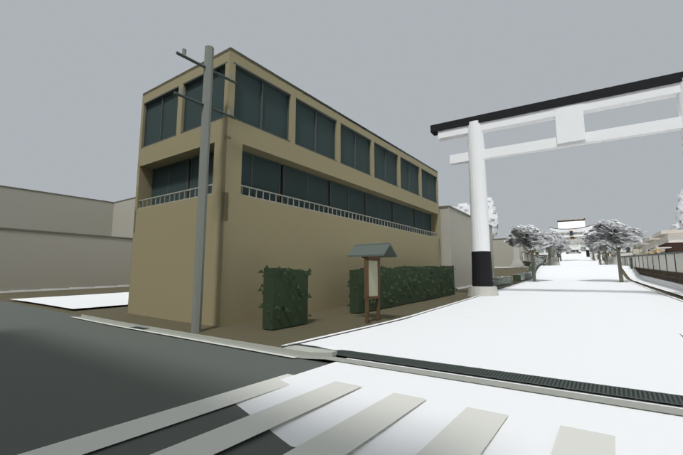
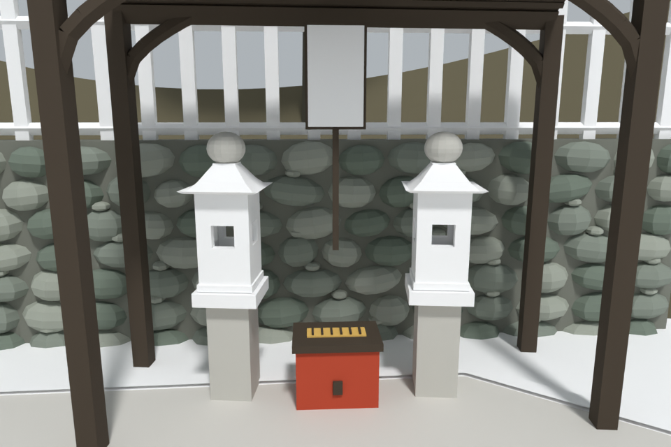

# R96 reviewed geometry checkpoint

Eight Sol 6.1 sector/review agents contributed under one integration owner. One
Blender CPU renderer ran at a time. The [production report](../precinct-production-r96.md)
contains the sector matrix, source registration, corrections and remaining work.

These are **diagnostic renders of the actual integrated geometry**, not native
browser screenshots. White surfaces stand in for texture-based materials;
foliage cutouts, canvas lettering and custom shaders are not reproduced. They
verify placement, connected parts, silhouettes and surface conflicts, not final
Three.js appearance, measured historical exactness or browser frame rate.

## Reviewed views

|Area|Final view|What was checked|
|---|---|---|
|Omotesando|[Entrance](omotesando-oblique.png)|Registered apartment, true gallery recess, hedge, small roofed panel, crossing and first torii|
|Romon|[Gallery](romon-closeup.png)|Bracket joinery, capitals, stone shoes and end fittings|
|Gehaiden|[Front](gehaiden-front.png)|Stage, woven-screen borders and removal of duplicate cream lanterns|
|Naihaiden|[Side](naihaiden-side.png)|Lantern pair, transom frames and shade headers|
|Honden|[Rear/side](honden-closeup.png)|Veranda returns, rafters, drainage and net supports|
|Shinkosui|[Well context](well-context.png)|Mapped roofed well and corrected adjacent apron surfaces|
|Tamayama/Okumiya|[Aerial](tamayama-aerial.png)|Canopy, understory, open landing and registered boundary returns|
|Okusha/Omokaru|[Context](omokaru-context.png), [close view](omokaru-west.png)|Relocated interactive stones, real apertures, cap seating, attached braces and cobble boundary|
|Yotsutsuji|[Aerial](yotsutsuji-aerial.png)|Sitting platforms, furniture, vegetation and clear arrival|

## Evidence

- [520 passing tests](tests.txt), run after the final chamber correction.
- [Actual assembly audit](assembly-audit.json): 24 original route records and
  parsed R96 builder reports. The original 22 clear / 2 inspect classification
  is retained; it was not relabeled to hide center-rail collisions.
- [Complete rail-side corridors](inspect-route-owners.json), explained in the
  [route investigation](../route-inspect-review-r96.md): both full routes, both
  directions and both sides of each divider pass for the sampled player radius.
  Gonden's audit begins at the measured clear exterior point.
- [Arrival](arrival.json): crossing position and zero spawn correction.
- [Shared floor benchmark](path-top-ownership-benchmark.json): actual triangle
  ownership, UV preservation and CPU startup timings; not FPS.
- [Final former-conflict rays](omokaru-chamber-ray-fixed.jsonl): one nearest
  chamber surface at each formerly duplicated sample.
- [Entrance review](review-final-notice-hedge.md) and
  [chamber review](review-final-chamber-overlap-fixed.md).
- [Camera poses](cameras.json), in original Three world coordinates (Y up).
- [Source SHA-256](source-sha256.json): bytes of the working sources and local
  geography files used for this verification. Git checkout line-ending
  normalization can change these byte hashes without changing the geometry.

Renderer: Blender 5.2, Cycles CPU, six threads, 960 × 640, 12 samples, seed 95.
The final local assets and working scripts remain under `outputs/r96-integrated/`;
large mesh exports and Blender intermediates are intentionally not committed.
Third-party reference photographs are linked in each sector document, not
redistributed as project assets.

## Not closed by this checkpoint

Native browser visual/interaction review and FPS measurements remain unverified.
The [Shinsenjo grade conflict](../shinsenjo-grade-reconciliation-r96.md) still
prevents enabling its full compound. Exact hidden frontage details, decorative
motifs, materials and some photo-inferred dimensions need further source work.
This packet does not declare the entire precinct identical to the real shrine.
